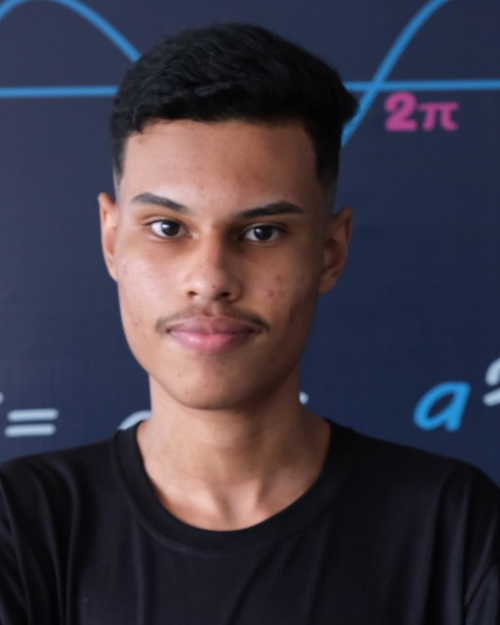

# Lua → Python

<div class="hero" markdown="1">

<p class="eyebrow">COMPILADORES 1 · UNB / FCTE · 2026.2</p>

## Da linguagem à execução

Um transpilador construído em C++17, Flex e Bison. Esta documentação reúne a especificação, a implementação, os testes e a trajetória do Grupo 2 durante o semestre.

[Executar o compilador](guia/instalacao.md){ .md-button .md-button--primary }
[Acompanhar as semanas](gestao/cronograma.md){ .md-button }

</div>

<div class="grid cards" markdown="1">

- **Projeto e equipe**

    Objetivos, responsabilidades, requisitos e limites do subconjunto Lua.

    [Conhecer o projeto](projeto/visao-geral.md)

- **18 semanas de trabalho**

    Calendário de 10 de agosto a 9 de dezembro, com evidências do histórico.

    [Consultar o cronograma](gestao/cronograma.md)

- **P1 · P2 · T · C**

    Prazos, critérios, materiais disponíveis e preparação para a entrega.

    [Ver os pontos de controle](entregas/index.md)

- **Arquitetura e qualidade**

    Léxico, parser, AST, semântica, geração Python, testes e Valgrind.

    [Explorar a implementação](tecnico/arquitetura.md)

</div>

## O que o compilador faz

```text
Lua → Flex → Bison / AST → resolução de nomes → validação semântica → Python + runtime
```

O executável `build/lua2py` aceita um arquivo `.lua` ou a entrada padrão. A saída é um programa Python autossuficiente. Erros de compilação são enviados a `stderr` e retornam código 1.

## Situação documentada

**Referência: 27/11/2026, America/Bahia.** A documentação descreve o commit [`1c5e2e3`](https://github.com/PVictorMSI/GRUPO2-COMP2026.2/commit/1c5e2e3bcb7de59f86bffb9cf0c527081a313a43) e a consulta às issues. O [registro de fontes](fontes/index.md) permite reproduzir a análise.

- **144 verificações locais aprovadas**, nenhuma falha; Valgrind indisponível nesta execução.
- **55 issues catalogadas**, incluindo épicos, frentes e um registro de teste de integração.
- **4 épicos no Projects**: gerenciamento, especificação, implementação e testes/documentação.
- Entrevistas finais previstas para **30/11 e 02/12/2026**. A data individual da equipe não foi localizada.

!!! attention "Estado da issue e evidência técnica"
    Issues fechadas registram o estado no GitHub, mas não substituem a verificação do código. As [divergências e limitações](projeto/limitacoes.md), inclusive a ausência de uma RI separada, estão registradas explicitamente.

## Equipe

<div class="team-grid">
<div class="team-card"><a href="https://github.com/Camile0318"><br><strong>Camile</strong></a><br><span>@Camile0318</span></div>
<div class="team-card"><a href="https://github.com/Giih-martins"><br><strong>Giovana Martins de Brito</strong></a><br><span>@Giih-martins</span></div>
<div class="team-card"><a href="https://github.com/Joaolramos"><br><strong>João Ramos</strong></a><br><span>@Joaolramos</span></div>
<div class="team-card"><a href="https://github.com/PVictorMSI"><br><strong>Paulo Victor Mendes Silva</strong></a><br><span>@PVictorMSI</span></div>
<div class="team-card"><a href="https://github.com/ChickRicks"><br><strong>Ricardo</strong></a><br><span>@ChickRicks</span></div>
</div>

[Responsabilidades completas](projeto/equipe.md) · [Repositório](https://github.com/PVictorMSI/GRUPO2-COMP2026.2) · [Projects](https://github.com/users/PVictorMSI/projects/1/views/6)
