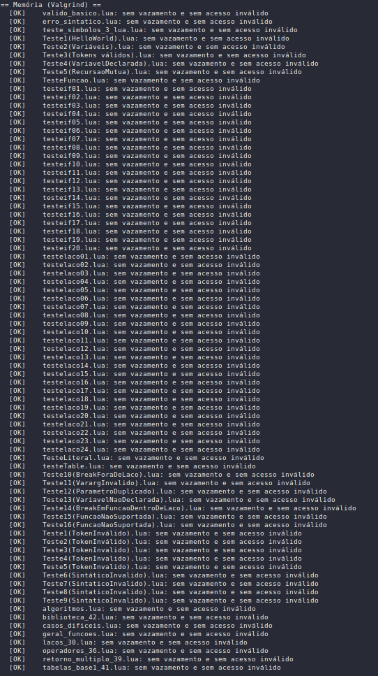

# Valgrind e gerenciamento de memória

**Issue:** [#55](https://github.com/PVictorMSI/GRUPO2-COMP2026.2/issues/55) — Rodar Valgrind e corrigir leaks encontrados.

**Responsáveis registrados:** [@Giih-martins](https://github.com/Giih-martins), [@Joaolramos](https://github.com/Joaolramos).

**Estado consultado em 27/11/2026:** fechada.

**Critério:** relatório sem leaks para os casos de teste definidos.

## Evidência fornecida



A captura fornecida pela equipe mostra a etapa de memória com resultados `[OK]` para entradas válidas, erros léxicos/sintáticos/semânticos e programas de geração. Ela é preservada no arquivo `docs/conteudo/assets/valgrind.jpeg`.

A imagem não apresenta data, hash do commit, versão da ferramenta nem logs brutos completos. Portanto, documenta o resultado exibido para aqueles casos, sem estabelecer uma garantia para qualquer entrada ou associar automaticamente o resultado ao commit atual.

## Como a suíte avalia memória

O script executa:

```bash
valgrind --leak-check=full ./build/lua2py < entrada.lua
```

Para aprovar cada caso, procura simultaneamente:

```text
definitely lost: 0 bytes
indirectly lost: 0 bytes
ERROR SUMMARY: 0 errors
```

A suíte não exige explicitamente `still reachable: 0 bytes`. A descrição da evidência deve respeitar esse critério: memória ainda alcançável não é sinônimo de perda definitiva. Casos inválidos também são analisados para verificar liberação de estruturas parciais.

## Reproduzir e guardar um relatório

```bash
make
mkdir -p /tmp/lua2py-valgrind
git rev-parse HEAD > /tmp/lua2py-valgrind/commit.txt
valgrind --version > /tmp/lua2py-valgrind/versao.txt
valgrind --leak-check=full --show-leak-kinds=all   --errors-for-leak-kinds=definite,indirect --error-exitcode=99   --log-file=/tmp/lua2py-valgrind/valido.log   ./build/lua2py Testes/unitarios/valido_basico.lua -o /tmp/lua2py-valgrind/valido.py
make check
```

Para uma entrada inválida, código 1 pode ser o retorno esperado do compilador; o código 99 acima indica erros detectados pelo Valgrind. Analise o relatório além do código de saída.

## Estratégia de propriedade

- `unique_ptr` libera filhos da AST ao destruir o nó proprietário.
- `%destructor` libera valores semânticos descartados pelo Bison em erros.
- O `main` libera `root` após a geração ou erros posteriores ao parsing.
- A tabela de símbolos mantém a posse dos símbolos enquanto as tabelas laterais os referenciam.

Esses mecanismos estão em [src/ast.hpp](https://github.com/PVictorMSI/GRUPO2-COMP2026.2/blob/1c5e2e3bcb7de59f86bffb9cf0c527081a313a43/src/ast.hpp), [parser/parser.y](https://github.com/PVictorMSI/GRUPO2-COMP2026.2/blob/1c5e2e3bcb7de59f86bffb9cf0c527081a313a43/parser/parser.y), [src/main.cpp](https://github.com/PVictorMSI/GRUPO2-COMP2026.2/blob/1c5e2e3bcb7de59f86bffb9cf0c527081a313a43/src/main.cpp) e [src/symbol_table.hpp](https://github.com/PVictorMSI/GRUPO2-COMP2026.2/blob/1c5e2e3bcb7de59f86bffb9cf0c527081a313a43/src/symbol_table.hpp). Não foi identificado um commit isolado que permita atribuir todas as correções de memória exclusivamente à issue #55.

## Verificação desta documentação

O `make check` local passou em **144 verificações**, mas **pulou Valgrind** por ausência da ferramenta. A captura acima é evidência histórica, não resultado de uma nova execução nesta sessão. Veja o [log local](../fontes/verificacao-local.txt).

Relacionadas: [#46](https://github.com/PVictorMSI/GRUPO2-COMP2026.2/issues/46) (AST), [#47](https://github.com/PVictorMSI/GRUPO2-COMP2026.2/issues/47) (RI planejada), [#49](https://github.com/PVictorMSI/GRUPO2-COMP2026.2/issues/49) e [#53](https://github.com/PVictorMSI/GRUPO2-COMP2026.2/issues/53) (robustez).
